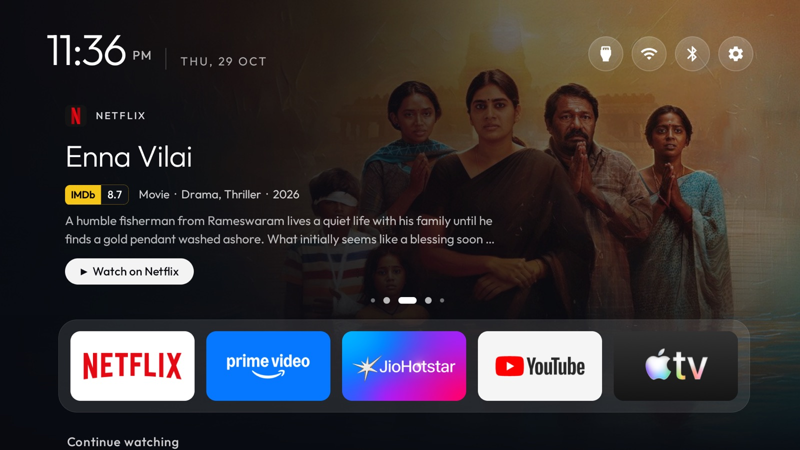
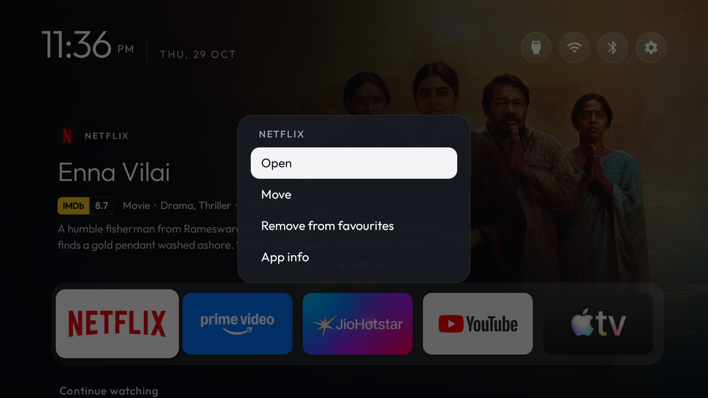
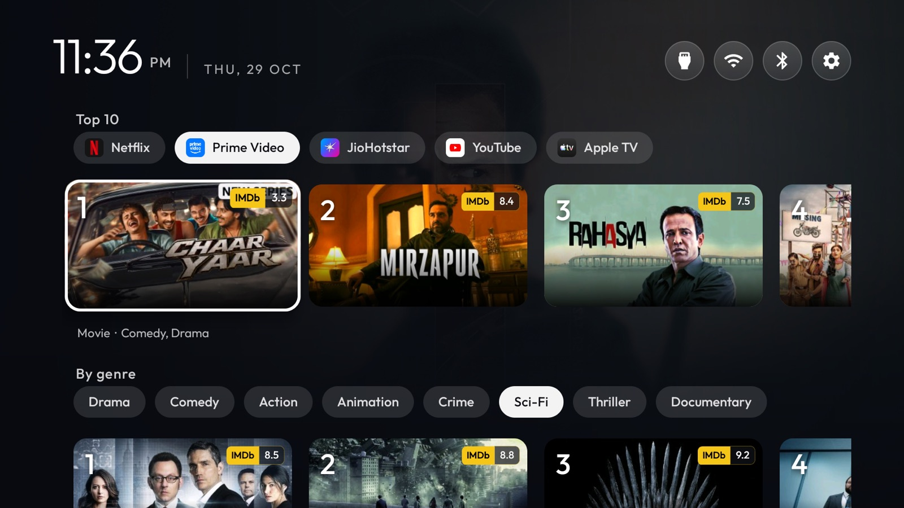
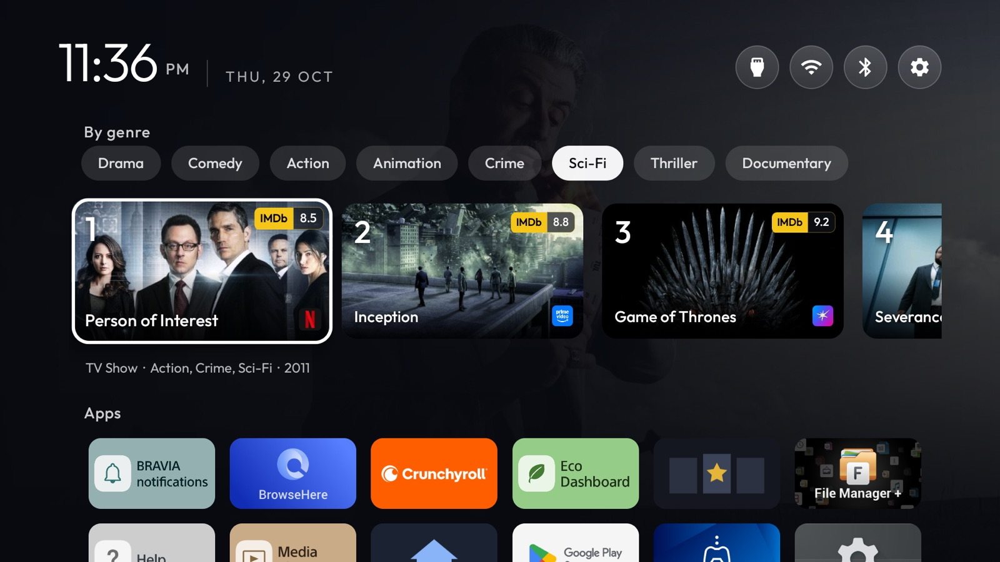
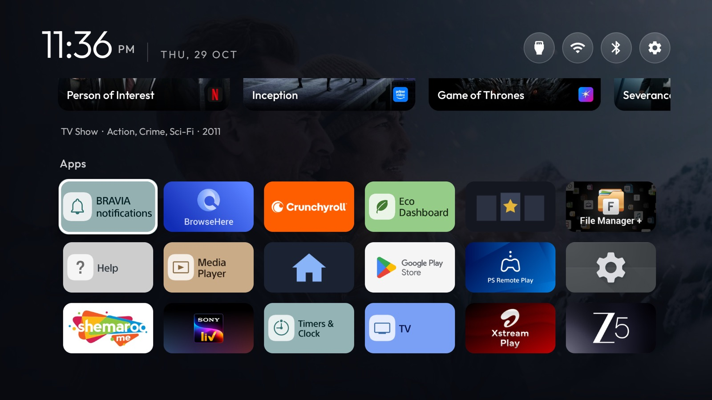

# CleanYourTV, Home edition

A fork of [Gathin23/cleanyourtv](https://github.com/Gathin23/cleanyourtv) that turns its clean, ad-free Android TV
launcher into a full home screen: new releases from your streaming apps in the header, IMDb ratings everywhere,
Continue watching, a Top 10 per app, rows by genre, and your favourite apps in a drawer you arrange yourself.
Still no ads, no sponsored rows and no tracking, and the launcher itself never goes online.

Built and running on a Sony BRAVIA BF1 (Google TV 12). Everything in this README is on the `custom-home` branch.
The original project's README, with the debloat guide and the launcher's own documentation, is in
[README.upstream.md](README.upstream.md).

## What's on Home, top to bottom

| | |
|---|---|
|  | **Header carousel.** Recent releases on your drawer apps, from the last 14 days, judged by each title's original release date, not the date it reached streaming: films and shows first out in the last 12 months, and new seasons. This year's titles come first, then new seasons, then the rest, best IMDb rating first within each; a title on two services shows once. **It follows the drawer:** with an app focused, the header is 15 of that app's new releases only, its 5 best and 10 drawn from the rest; on YouTube, its new videos (up to a week old, or live): your Subscriptions and Recommended rows taken in turn, then Trending, never YouTube Music; on an app with nothing new, 5 from each drawer app, the 2 best and 3 drawn. Each refresh draws again. It shows the app's logo, the title, then IMDb rating · year · genres · season (for a new season), and a line of plot over the full-screen backdrop, and turns every 8 seconds. Press Up from the drawer to take it over: Left and Right turn it round, OK opens the app. YouTube is left out. |
|  | **App drawer.** Your favourite apps on one line; the tiles shrink so every app fits. Edit it the Google TV way: hold OK on an app for **Open, Move, Remove from favourites, App info**, and hold OK on any app under Apps to **Add to favourites**. |
|  | **Continue watching**, from the apps that publish it, with progress bars, ratings and the app's badge. Hold OK on a title to **remove it from Continue watching**: it stays gone across restarts and comes back only once you watch it again. Then **Top 10**: a tab per drawer app, and Left and Right change the row. Under a row, the focused title's type, genres and year. |
|  | **By genre.** Drama, Comedy, Action, Sci-Fi and more, each row taking your drawer apps in turn so no single app fills it. |
|  | **Apps.** Every other installed app. |

The top bar has the clock, a short date, `Refreshing · 40%` under it while a refresh runs, and icon buttons for Inputs, Wi-Fi, **Bluetooth** (it opens Remotes &
Accessories) and Settings. Google's ambient screensaver stays.

## Features

**Home**
- Header carousel of recent releases (this year's first) with animated dots, focusable, opening the title's app.
- Continue watching titles can be removed with a long press; they return only when watched again.
- App drawer on one line, edited with a long press: move, remove, add, app info.
- Continue watching, Top 10 per app (tabs), Top 10 by genre (tabs), and the full app grid.
- IMDb tag on every rated tile and in the header; TV show or Movie, genres and year in captions.
- Netflix's N as its small mark; poster backdrops behind the clock; focus lift, rings and glass.
- Bluetooth button straight to Remotes & Accessories; icon-only top bar; date as `THU, 29 OCT`.

**Ratings and data**
- IMDb ratings through the StreamRatings shared cache, the same one the StreamRatings browser extension uses, then
  OMDb directly only while that cache is down.
- Ratings kept on the TV by release age, StreamRatings' rule: 3 days for titles from the last 3 months, 5 days up to
  a year and for series still airing, 15 days up to five years, 30 beyond; misses are retried after 5 days.
- New releases, popular titles and genre pools from TMDB, for India (`watch_region=IN`).
- Genre and type from OMDb or TMDB; TMDB's paired genres ("Action & Adventure") merged into one name.

**TV clean-up** (from the original project, applied with its tested list for this model)
- Samba TV (on-screen content tracking for ads), Sony promos and Sony Select, Google feedback, demo mode and four
  preloaded apps disabled, never uninstalled.
- AdGuard ad-blocking DNS (does not block YouTube ads).
- One command undoes all of it.

**Add-ons in this fork**
- [`addons/tv-feed`](addons/tv-feed): the Feed add-on, which gathers everything above for the launcher.
- [`addons/original-home`](addons/original-home): one press to the TV's own home screen, where the stock launcher
  is kept enabled.

## How it works

```
 streaming apps ──(Watch Next, preview channels)──┐
 TMDB (new releases, popular, genres) ────────────┤
 StreamRatings shared cache → OMDb (ratings) ─────┤
                                                  ▼
                                Feed add-on (io.github.rohan9405.feed)
                                  refreshes, ranks, caches posters
                                                  │  content provider, signature-checked
                                                  ▼
                                CleanYourTV launcher (offline) → Home
```

- The **launcher** never goes online. It reads the Feed add-on's provider, which answers only apps signed with the
  same key, because the rows show what you watch.
- The **Feed add-on** holds the internet permission. It runs only when Home asks and its data is older than 20
  minutes, or when you press Refresh on its screen. There is no background service.

| Data | Refreshed |
|---|---|
| Continue watching, the apps' own rows | By each app, usually when you use it; Home re-reads them at most every 20 min |
| New releases, popular titles (TMDB) | Every 6 hours; the 14-day window moves daily |
| Genre pools, new seasons (TMDB) | Every 24 and 12 hours; a film's first release date is kept for a month |
| IMDb ratings | 3 to 30 days by release age |
| Posters | Downloaded once, kept on the TV, loaded per tile as it scrolls into view |

A normal refresh takes about 10 seconds in the background on the BRAVIA. Home shows the last saved rows at once, and
Continue watching and the apps' own rows update within a second or two, before TMDB is asked anything. TMDB is then asked
about your drawer apps only, all at the same time: add an app to the drawer and its rows are fetched straight away;
remove one and it is no longer fetched.

### Where recommendations come from

- **Personal to you:** Continue watching, and the rows the apps themselves publish (Prime Video, JioHotstar, ZEE5,
  Apple TV, Crunchyroll, YouTube's "Recommended for you"). The apps build these from your account.
- **Not personal:** the header, the Netflix and SonyLIV tabs (those apps publish no rows) and the genre pools come
  from TMDB, ranked by IMDb rating and popularity in India. They are quality-ranked, not taste-ranked.

## Set it up on your own TV

You need an Android TV or Google TV with network debugging on, and a computer on the same Wi-Fi. Builds need JDK 17
and Android SDK platform 34 (see [README.upstream.md](README.upstream.md#doing-it-by-hand)).

```bash
git clone -b custom-home https://github.com/rohan9405/cleanyourtv && cd cleanyourtv
python3 -m venv tools/venv && tools/venv/bin/pip install -r tools/requirements.txt
export TV_HOST=<tv ip>

# 1. Clean up the TV with its list (examples/<your tv>/debloat.txt), as the original README describes.
# 2. Install the launcher, the Feed add-on, and a theme that turns the new Home on (feed_package):
STOCK_LAUNCHER=none launcher/build-and-install.sh
tools/venv/bin/python -I tools/manage.py install tv-feed
tools/venv/bin/python -I tools/tv.py 'pm grant io.github.rohan9405.feed android.permission.READ_TV_LISTINGS'
tools/theme.sh my-tv/theme

# 3. API keys stay on your computer (~/.cleantv-private, never in the repo) and are sent over ADB:
my-tv/api-keys.sh save omdb      # free key from omdbapi.com
my-tv/api-keys.sh save tmdb      # TMDB API Read Access Token, free at themoviedb.org
my-tv/api-keys.sh send
```

On Google TV, the stock launcher keeps the Home button while it is enabled. [my-tv/README.md](my-tv/README.md) has
the hand-over steps used on the BRAVIA, and everything that was applied there.

**Preview first:** an Android TV emulator runs the same builds. The Feed add-on's demo mode fills Home with sample
rows when the emulator has none of your apps:

```bash
adb shell am start -n io.github.rohan9405.feed/.FeedActivity --ez demo true
```

## Switching back

| What | How |
|---|---|
| The TV's own home screen as default | `TV_HOST=<tv ip> tools/switch-home.sh stock` (`clean` switches back) |
| Undo everything: apps, home, screensaver, DNS | `TV_HOST=<tv ip> my-tv/restore.sh` |
| Only the original launcher look | `TV_HOST=<tv ip> tools/theme.sh --reset` |

## Limits

- **Netflix and SonyLIV publish no rows**, so their tabs show TMDB's popular titles in India, and their titles open
  the app's home, not the title.
- **"New"** means new films, new shows and new seasons. TMDB does not record when an older catalogue title was added
  to an app.
- **No "add to wishlist" in the apps:** Netflix's My List and Prime's Watchlist live in their accounts, with no way
  for another app to add to them.
- **Not built yet:** an IMDb overlay inside the Netflix and Prime apps, and a playback-speed control.

## Credits

[CleanYourTV](https://github.com/Gathin23/cleanyourtv) by Gathin23 and its contributors: the debloat lists and tools,
the launcher this Home is built into, and the safety rules followed here. MIT licence, as the original. Ratings via
OMDb; titles, artwork and genres via TMDB. This product uses the TMDB API but is not endorsed or certified by TMDB.
